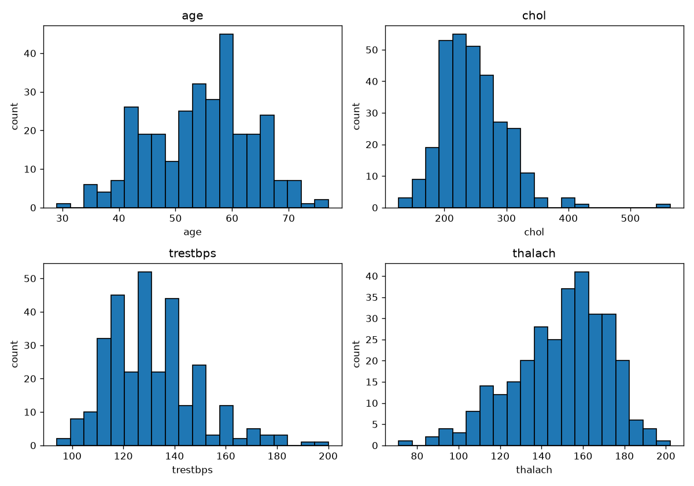
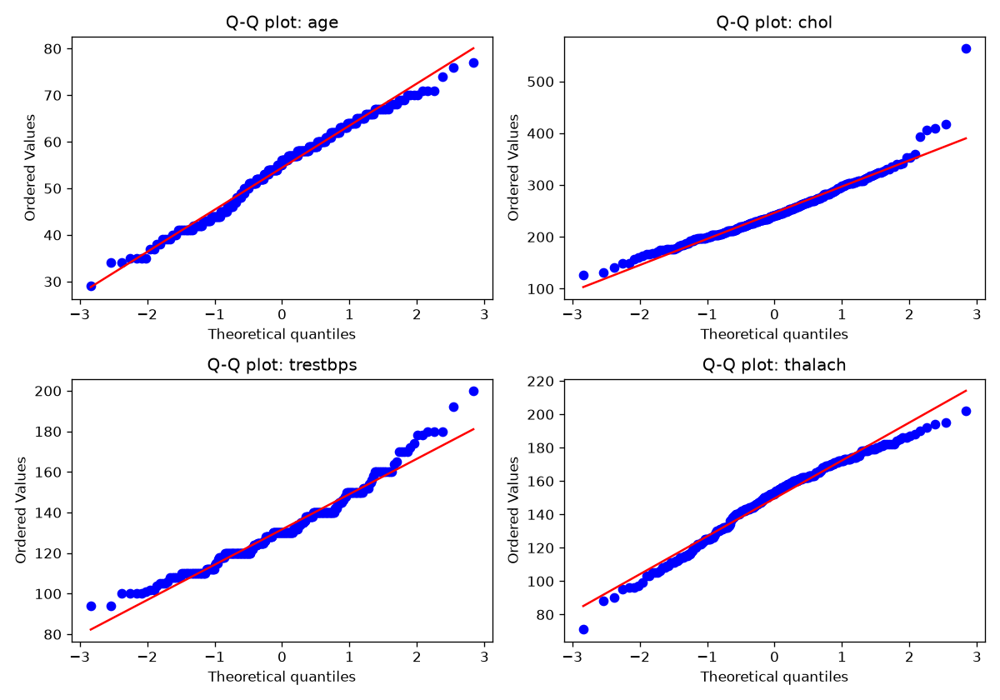
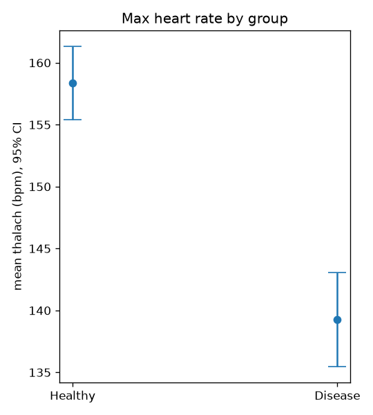
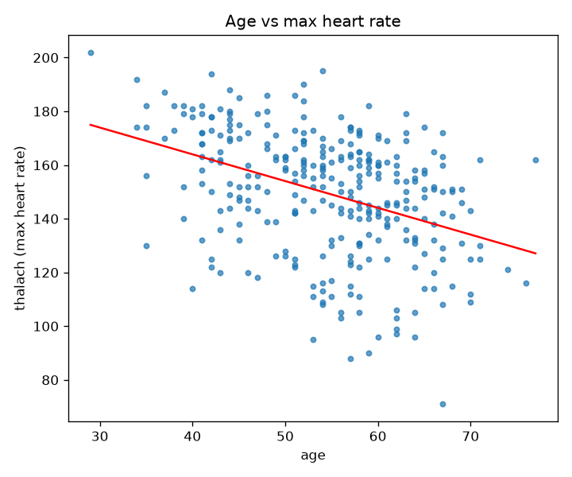
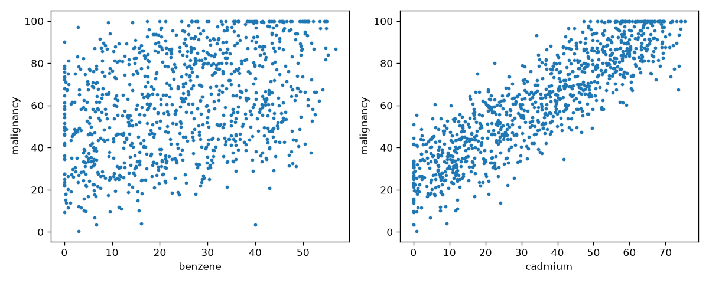
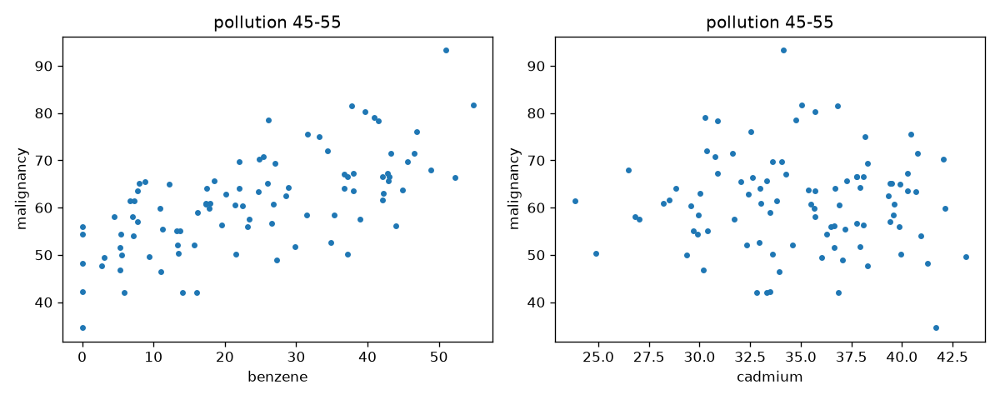

# PW3 — Data, Distributions, Testing, Causation

## Data sources

## Session 1

### Task 1 — Loading the data

### Task 2 — Shape of each variable
### Task 2 — Shape of each variable

I plotted the distribution of the four continuous variables in one figure with four panels (`hist.png`, script `task2.py`).

- **age**: roughly bell-shaped and fairly symmetric, with most patients between 45 and 65 years old and a peak around 58-60. The left side is slightly longer than the right (few young patients below 40).
- **chol** (cholesterol): clearly right-skewed. Most values lie between 200 and 300 mg/dl, with a peak around 220-240, and a long tail to the right. There is one extreme patient at about 560, far from everyone else.
- **trestbps** (resting blood pressure): right-skewed. The bulk of the values is between 110 and 140, with a peak near 120-130. A tail extends to the right towards 180-200, with a few high values.
- **thalach** (max heart rate): left-skewed. Most values are between 130 and 180, with a peak around 150-165, and a tail towards low values (down to about 70).

### Task 3 — Normality

To check normality I used two things: Q-Q plots (`qq.png`) and numbers (skewness, kurtosis and the Shapiro-Wilk test), made by `task3.py`.

| variable | skew | kurtosis | Shapiro p-value | verdict |
| age | -0.21 | -0.53 | 0.006 | approximately normal |
| thalach | -0.53 | -0.07 | 7e-05 | approximately normal |
| trestbps | 0.70 | 0.85 | 2e-06 | not normal |
| chol | 1.13 | 4.40 | 6e-09 | not normal |

The Shapiro test rejects exact normality for all four variables (p < 0.05). But with 303 patients this test finds even very small differences, so I did not use it alone and I also looked at the Q-Q plots and the skew and kurtosis.

- **age**: the points follow the red line almost perfectly and the skew is small, so I say it is approximately normal.
- **thalach**: the points are close to the line, with a small deviation at the low end. Skew is -0.53 and kurtosis is about 0, so I say it is approximately normal.
- **trestbps**: the points leave the line on the right side and the skew is 0.70, which matches the long right tail in the histogram. I say it is not normal.
- **chol**: the points bend away from the line and there is one extreme point at about 560. Skew is 1.13 and kurtosis is 4.4 (heavy tail). I say it is clearly not normal.

I will use these verdicts in Session 2: age and thalach can be treated as normal, while chol and trestbps need methods that do not assume normality.

## Session 2

### Task 4 — Is the effect real?

I wanted to know if patients with heart disease have a different maximum heart rate (`thalach`) than healthy people. I split `thalach` with `target`: 139 patients with disease (target = 1) and 164 healthy (target = 0). Script: `task4.py`.

**Method.** In Session 1, thalach was approximately normal and both groups are large, so I used Welch's t-test. I chose Welch because it does not assume that the two groups have the same variance. As a second check I also ran a Mann-Whitney test, which does not need normality.

**Result.**
- mean thalach, disease: 139.26 bpm
- mean thalach, healthy: 158.38 bpm
- Welch t-test: t = -7.86, p = 9e-14
- Mann-Whitney: p = 2e-13
- Cohen's d = -0.91 (a large effect)

**Conclusion.** The p-value is far below 0.05, and both tests agree, so the difference is real and not just chance. Patients with heart disease reach a maximum heart rate about 19 bpm lower than healthy patients.

**Uncertainty on the mean.** I computed the standard error of the mean (SEM) and the 95% confidence interval for each group:

| group | n | mean (bpm) | SEM | 95% CI |
| healthy | 164 | 158.38 | 1.50 | ± 2.96 |
| disease | 139 | 139.26 | 1.92 | ± 3.79 |

The plot (`means_ci.png`) shows the two means with their 95% confidence intervals. The two intervals are far from each other and do not overlap, so the picture agrees with the test: the groups really differ.

### Task 5 — Do age and thalach move together?

I checked if `age` and `thalach` rise and fall together. Both variables are approximately normal (Task 3), so I used the Pearson correlation, and the Spearman correlation as a second check. I also fitted a straight line. Script: `task5.py`.

- Pearson r = -0.394 (p = 1e-12)
- Spearman rho = -0.392 (p = 2e-12)
- slope = -0.997 bpm per year, intercept = 203.86

The correlation is negative: older patients tend to have a lower maximum heart rate, about 1 bpm less for each extra year. It is a moderate relationship, not a strong one, because the points are very spread around the line (age explains only about 15% of the variation, r² = 0.16).

## Dataset 2 — chemical exposure

### Task 6 — The naive analysis

I loaded `chemicals_cancer.csv`: 1000 patients and 5 columns (benzene, cadmium, pollution_index, age, malignancy). To see how strongly each chemical is linked to malignancy, I computed the Pearson correlation of each one with `malignancy` and plotted both. Script: `task6.py`.

- benzene vs malignancy: r = 0.385 (p = 1e-36)
- cadmium vs malignancy: r = 0.88 (p is so small that Python prints 0.0)

Both correlations are positive and significant, but cadmium is much stronger: its points follow a clear rising line, while the benzene points are much more spread out. Taken at face value, cadmium looks like the cause of malignancy, and benzene looks like a weak side factor. In Task 7 I check if this is really true.
### Task 7 — Look again

In Task 6 cadmium looked like the cause. But a third variable can make two things look linked if it influences both. The suspect is `pollution_index`: cadmium has a correlation of 0.982 with it, while benzene has almost none (0.054). So it is possible that pollution raises malignancy, and cadmium only follows pollution. Script: `task7.py`.

I tested this in two ways.

**1. Patients with similar pollution.** I cut the data into narrow pollution groups (width 10) and recomputed the correlation with malignancy inside each group, so pollution is almost constant there.

| pollution_index | n | benzene r | cadmium r |
| 30-40 | 95 | 0.779 | 0.157 |
| 40-50 | 100 | 0.721 | 0.041 |
| 50-60 | 100 | 0.779 | 0.151 |
| 60-70 | 94 | 0.771 | 0.062 |
| 45-55 | 94 | 0.658 | -0.040 |

**2. Partial correlation.** I removed the effect of pollution from benzene, cadmium and malignancy (fitting a straight line on pollution and keeping what is left), then correlated the leftovers:
- benzene: r = 0.755 (p = 7e-185)
- cadmium: r = 0.013 (p = 0.69)

**What happens.** Benzene stays strongly linked to malignancy in every group (r about 0.7-0.8), and after removing pollution it is still r = 0.755. Cadmium falls from r = 0.88 to about 0 (r = 0.013, p = 0.69, so no link at all). In the plot for pollution 45-55, the benzene points still go up, but the cadmium points are just a flat cloud.

**Conclusion.** Benzene is the real cause of malignancy. Cadmium only looked guilty because it follows the pollution index (r = 0.98), and pollution is linked to malignancy. Once pollution is held fixed, cadmium has no effect left. Age does not matter (r = -0.034 with malignancy).

One limit: this analysis shows it under the idea that pollution is the confounder. A statistics analysis alone cannot fully prove causation, but here benzene is the only chemical whose link survives.
## Summary

- **Normality (Session 1):** age and thalach are approximately normal; trestbps and chol are not (right-skewed).
- **Heart rate comparison:** patients with disease have a lower max heart rate (139.3 vs 158.4 bpm), Welch t-test p = 9e-14, Cohen's d = -0.91.
- **Age and heart rate:** negative correlation, r = -0.39.
- **Chemicals:** naive analysis points to cadmium (r = 0.88 vs 0.38 for benzene). After accounting for pollution_index, cadmium's link disappears (partial r = 0.013) and benzene's stays (partial r = 0.755). **Benzene is the real cause of malignancy; cadmium only looked guilty because it follows pollution.**